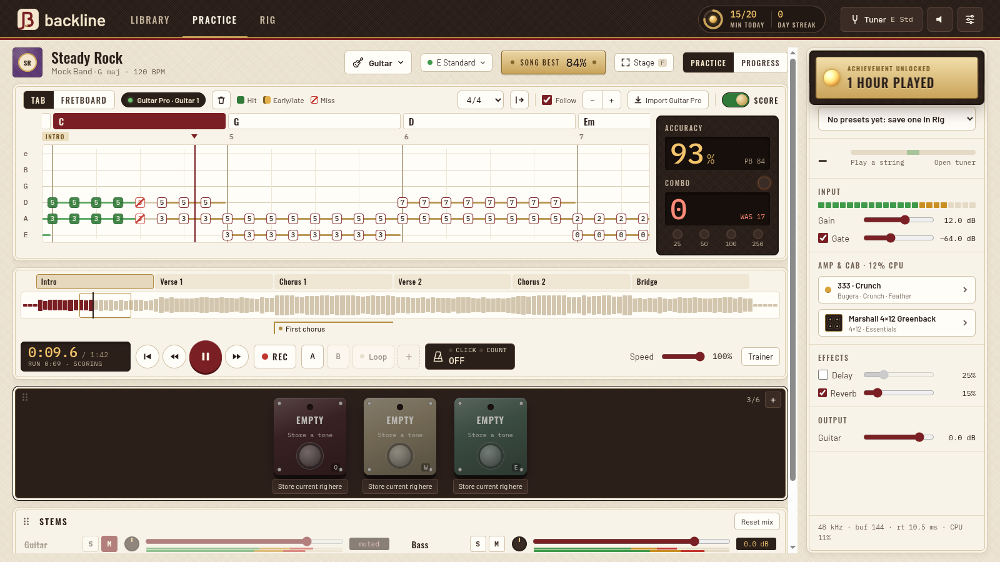
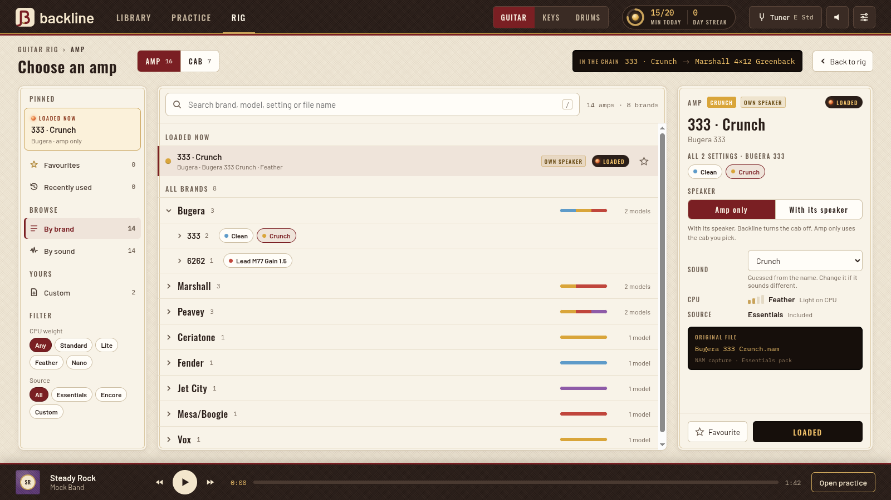
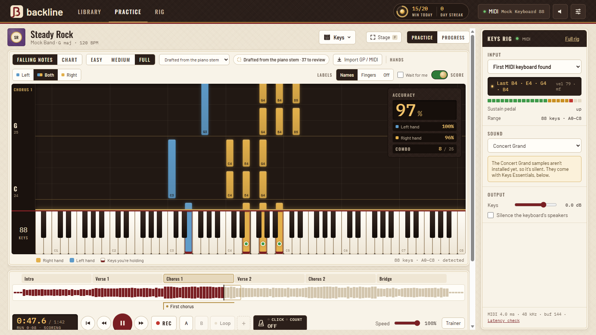
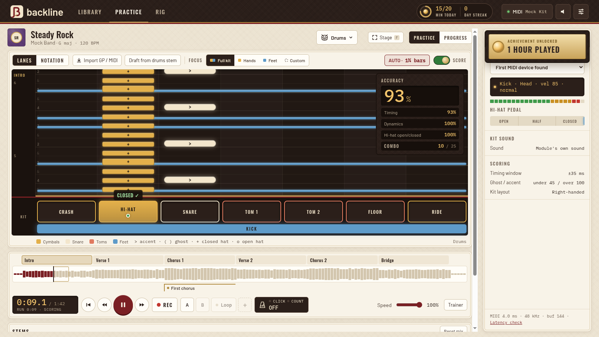
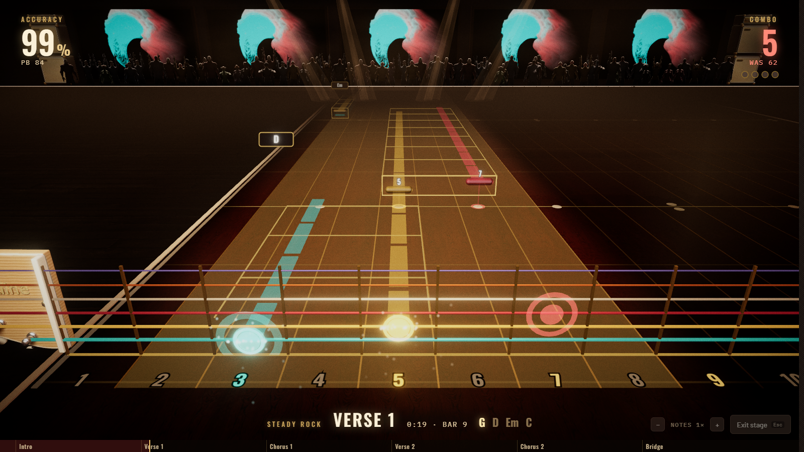
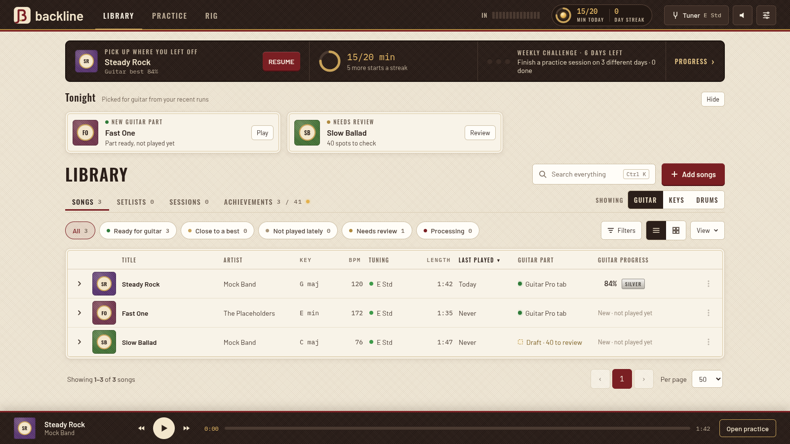

# Backline

**Plug in, play along.** Backline is a practice app for guitar, bass, keys and drums. Drop in any song and it splits it
into stems, finds the key, tempo, chords and sections, and gives you a part to play along to, with your amp sound,
scoring and loops. Everything runs on your own computer.

## Download

Get the latest installer from **[Releases](../../releases/latest)**. Older versions stay there too.

- **Windows:** `Backline-x.y.z-setup.exe`. The installer isn't code-signed yet, so Windows may say "Windows protected
  your PC": click **More info › Run anyway**.
- **macOS (Apple Silicon: M1 and newer):** `Backline-x.y.z-mac.dmg`. Open it and drag Backline to Applications. The
  app isn't signed by Apple yet, so the first time you open it macOS blocks it: go to **System Settings › Privacy &
  Security**, scroll down and click **Open Anyway**. Allow the microphone when it asks, so Backline hears your
  instrument.

The download is small (about 20 MB). The first-run setup downloads the rest: the sound packs you pick, and a one-time
download for song processing (Windows: about 3 GB, 5 GB installed; Mac: about 400 MB, 1 GB installed).

## What it does

**Your songs, ready to play**
- Drop in an mp3, flac, wav, m4a or similar. Backline splits it into six stems (vocals, drums, bass, guitar, piano,
  other) and finds the key, tempo, beat grid, chords and sections (intro, verse, chorus...).
- Mute, solo or turn down any stem: take the guitar out and play it yourself.
- Slow it down without changing the pitch, loop any part, and count in.

**Guitar**
- Amp models (NAM captures) and speaker cabinets, with a gate, delay and reverb. Low-latency monitoring, so you hear
  your processed guitar as you play.
- Import a Guitar Pro tab and Backline lines it up with the recording and sets the song's tuning. Play a tab in Eb
  Standard, Drop C and the like in E Standard or Drop D: the song shifts to match.
- Tuner, alternate tunings, and stored tones per song that you switch like pedals.

**Bass**
- Tab (4 or 5 strings), a fretboard and a staff view, from the song's bass track or your Guitar Pro and MIDI files.
- A kick drum lane under the tab shows how far ahead or behind the kick each note lands, and a groove trainer speeds
  up as you stay in the pocket.
- A bass rig with its own amp, compressor and EQ.

**Keys and drums**
- Plug in a MIDI keyboard or electronic kit. Backline drafts a keys part and a drum part from the song, or you
  import your own (Guitar Pro or MIDI).
- Falling notes or a chord chart for keys, with "wait for me" and left / right hand practice.
- Lanes or notation for drums, with timing, dynamics and hi-hat scoring, and a focus on hands, feet or any mix.

| Keys | Drums |
|---|---|
|  |  |

**Practice that adds up**
- Scoring as you play: hits, early or late notes, misses, combos and personal bests per song, section and loop.
- Section heat: each section is coloured by how you've played it lately, so the weak spots show.
- Speed trainer: start slow and step the speed up after clean passes.
- Mark spots, record takes, and drive it all from keyboard shortcuts, a spare MIDI pad or key, or a footswitch.
- Daily goal, streaks, achievements, practice sessions and setlists with a play mode for running a set.
- Stage mode: a big play-only view you can read from across the room.

## Coming soon

- Clean amps are no longer much quieter than distorted ones: every amp is levelled for how you actually play.

## What you need

- **Windows 10 or 11**, 64-bit, with a CPU that has AVX2 (almost anything from 2013 on), or **a Mac with Apple
  Silicon** (M1 or newer) on macOS 13 Ventura or later. Intel Macs aren't supported.
- **8 GB of RAM**, 16 GB recommended for importing songs.
- **Disk:** about 5 GB on Windows (1 GB on a Mac) for song processing, plus 50 to 100 MB per song.
- **Imports:** about a minute on Windows with an NVIDIA graphics card, several minutes on the CPU; about two minutes
  on an M1.
- **For guitar:** an audio interface or a Rocksmith Real Tone Cable. On Windows, an interface with an ASIO driver gives
  the lowest delay; on a Mac, any interface works with low delay as it is (the Real Tone Cable isn't tested
  on a Mac yet).
- **For keys and drums:** a MIDI keyboard or electronic drum kit to be scored.
- An internet connection for the first setup.

## How to update

From 0.4.0, Backline tells you when a new version is out: a window on the library when you open the app. Click
**Download** to open the release page. On 0.3.0 or older the app can't tell you (its Check for updates doesn't work),
so look at **[Releases](../../releases/latest)** yourself. The downloads are in this private repo, so
be signed in to GitHub with the account that was invited. Then:

- **Windows:** close Backline, download the new `Backline-x.y.z-setup.exe` and run it. It updates the installed app in
  place, so there's nothing to uninstall first.
- **macOS:** quit Backline, download the new `.dmg`, open it and drag Backline to Applications, then choose
  **Replace**. macOS may block the new version once, like the first install: **System Settings › Privacy & Security ›
  Open Anyway**.

Your songs, progress, amp models, sound packs and settings stay as they are. Song processing doesn't need to be set up
again; if a new version needs something extra for it, it downloads that on its own at the first launch.

## Removing it

- **Windows:** uninstall Backline from Settings › Apps. Your songs, amp models and settings are kept.
- **macOS:** first open Backline's **Settings › Storage › Remove song processing** (it frees about 1 GB that the app
  can't remove once it's gone), then drag Backline from Applications to the Bin. Your songs, amp models and cabs stay in
  the Backline folder in your home folder; settings and sounds are in `~/Library/Application Support/Backline`.

## Feedback

This is a private test build: please don't pass the installer on. Tell Giordano what worked, what didn't, and what
you'd want next.

Backline is free to use, closed source; see [LICENSE](LICENSE). Credits for the amp captures, samples and libraries
are in the app under Settings › About.
